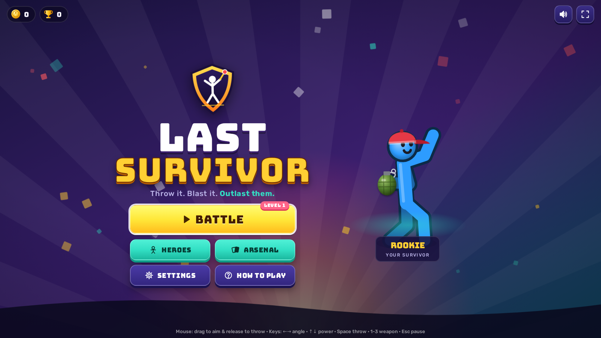
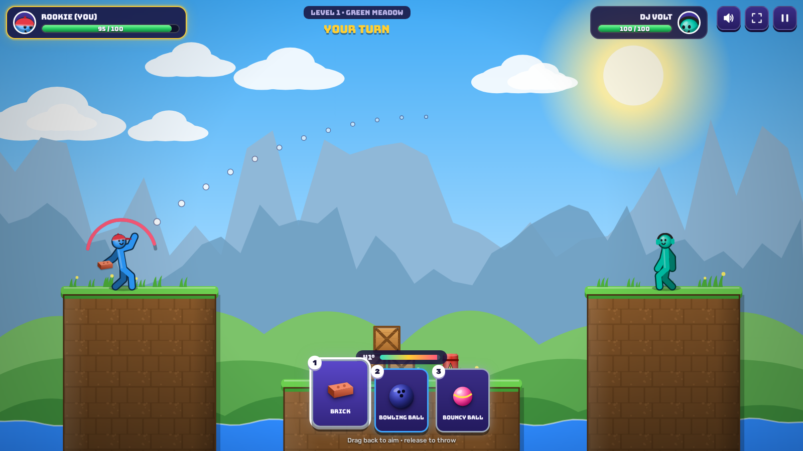
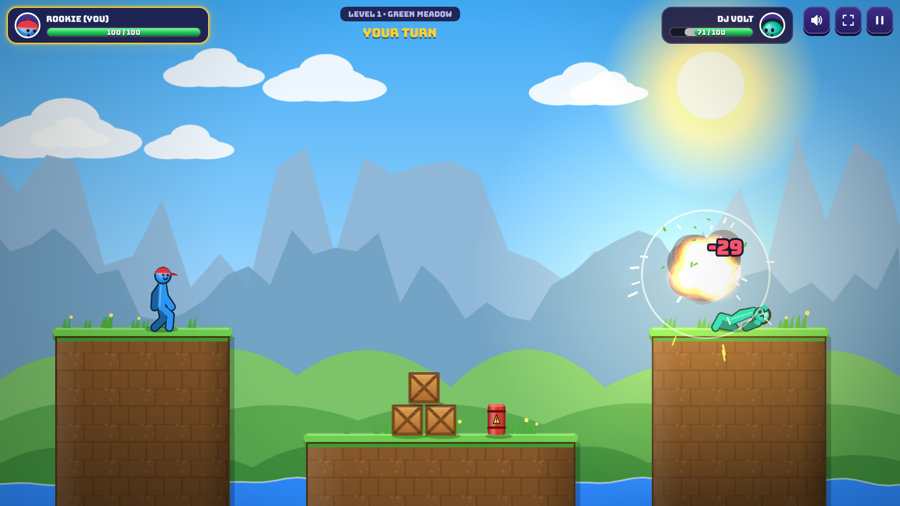
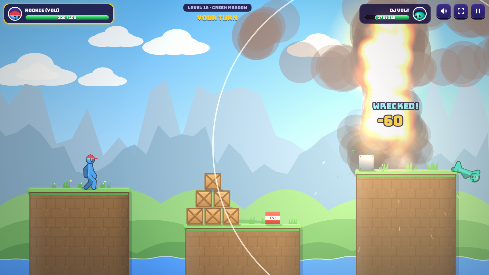
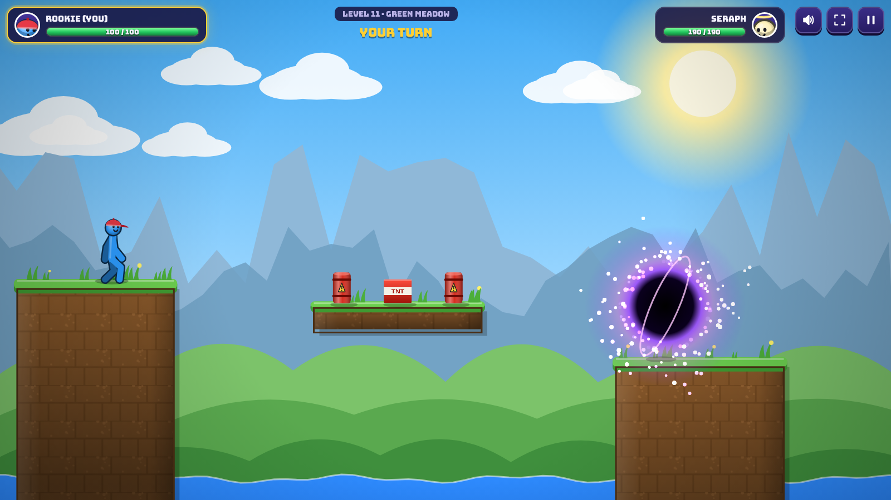
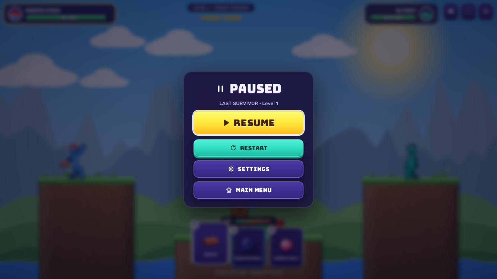
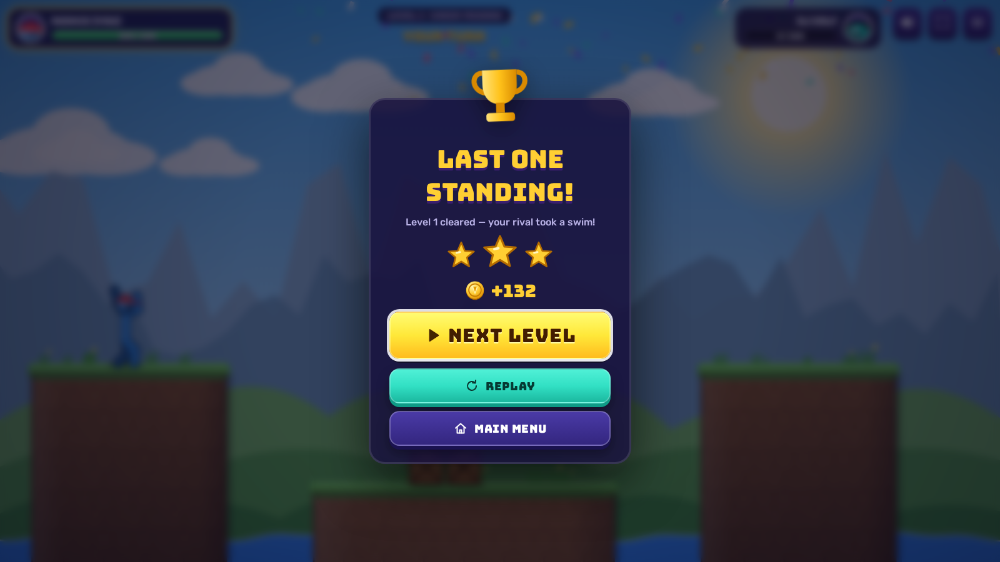
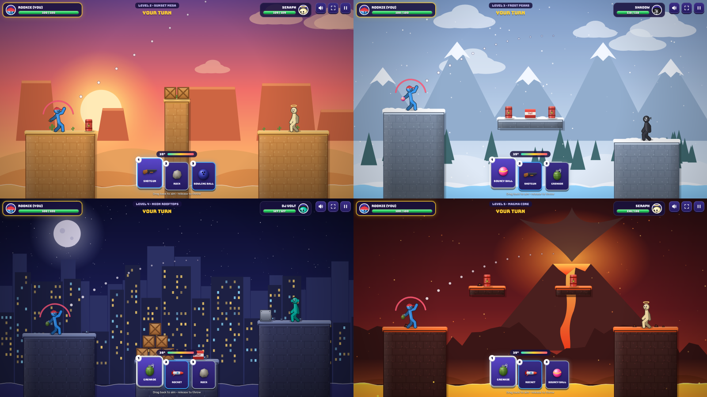
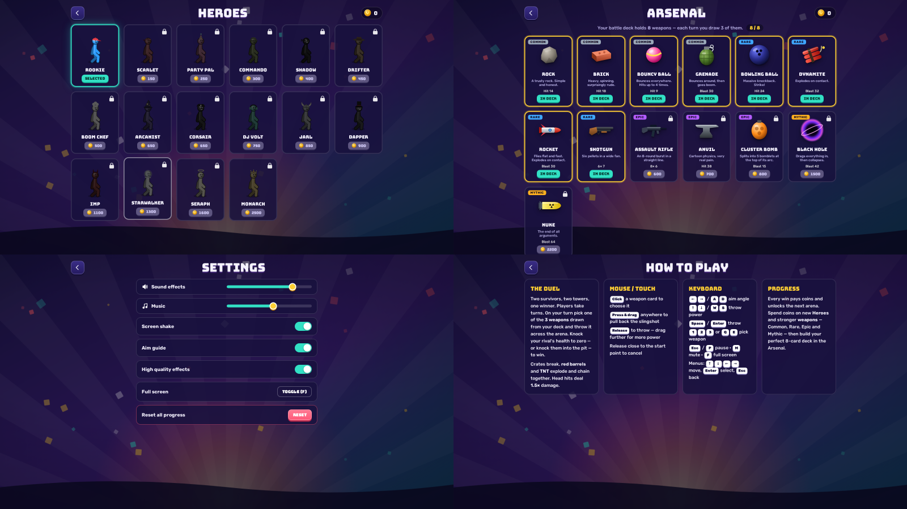

# Last Survivor

A turn-based ragdoll stickman duel for the browser (HTML5 Canvas + Web Audio, no dependencies).
Pick a hero, build an 8-weapon deck, and throw everything you have across the arena. Only one walks away.



## Play

Open `index.html` in a browser, or serve the folder:

```bash
npx http-server -c-1 .     # then open http://localhost:8080
```

It works from `file://` too. No build step is needed.

## How it plays

* Two fighters stand on opposite towers and take turns.
* Each turn you draw **3 weapons** from your **8-card deck**. Pick one, pull back the slingshot and let go.
* Hits turn the stickmen into physics ragdolls. Head hits deal **1.5×** damage.
* Crates break. **Red barrels** and **TNT** explode and set each other off.
* If you fall into the pit (water, sand, void or lava) you lose **30 HP** and drop back onto your tower.
* Bring your rival to 0 HP to win. Wins pay coins and unlock the next arena. There are 5 themed arenas and 5 map layouts, and enemy HP, weapons and aim improve as you level up.
* Spend coins on **16 heroes** and **13 weapons** (Common, Rare, Epic, Mythic), then build your deck in the **Arsenal**.

| Weapon | Rarity | Behaviour |
|---|---|---|
| Rock, Brick | Common | Solid hit, spins |
| Bouncy Ball | Common | Bounces and can hit up to 4 times |
| Grenade | Common | Bounces, then explodes when its fuse runs out |
| Bowling Ball | Rare | Heavy knockback |
| Dynamite | Rare | Explodes on contact |
| Rocket | Rare | Flat, fast flight with a smoke trail; explodes on contact |
| Shotgun | Rare | Fires 6 pellets in a fan |
| Assault Rifle | Epic | Fires an 8-round burst |
| Anvil | Epic | Very heavy and very painful |
| Cluster Bomb | Epic | Splits into 5 bomblets at the top of its arc |
| Black Hole | Mythic | Pulls everything in, then collapses |
| Nuke | Mythic | Screen flash, shockwave and a mushroom cloud |

## Controls

| Action | Mouse / touch | Keyboard |
|---|---|---|
| Aim & power | Press and drag back (slingshot) | `←` `→` / `A` `D` angle · `↑` `↓` / `W` `S` power |
| Throw | Release | `Space` / `Enter` |
| Pick weapon | Click a card | `1` `2` `3`, `Q` / `E` (or `Tab`) to cycle |
| Pause / resume | Pause button | `Esc` / `P` |
| Menus | Click buttons | Arrow keys to move, `Enter` to select, `Esc` / `Backspace` to go back |
| Mute / full screen | HUD buttons | `M` / `F` |

## Project structure

```
index.html                 markup for every screen (loading, main, heroes, arsenal, settings, help, HUD, pause, result)
css/style.css              all styling (Bungee + Rubik fonts, neon/indigo theme, responsive rules)
js/                        10 modules, loaded in this order:
  config.js    01  namespace, tuning constants, weapons, heroes, themes, map templates, asset manifest
  utils.js     02  math, seeded RNG, geometry, save data (localStorage), fullscreen
  assets.js    03  image loader + SVG→bitmap raster cache
  audio.js     04  synthesised SFX + procedural music sequencer (Web Audio)
  input.js     05  keyboard + pointer (mouse/touch) input
  physics.js   06  verlet ragdoll solver, circle-vs-AABB collision, trajectory prediction
  world.js     07  arena terrain, destructible props, hazard pit, particles, lights, floating text
  entities.js  08  Fighter (IK-animated stickman ⇄ ragdoll), Projectile (all weapon kinds), explosions
  ui.js        09  menus, shops, settings, HUD, banners, keyboard spatial navigation
  game.js      10  main loop, camera, turns, aiming, enemy AI, render pipeline, boot
assets/
  fonts/                   Bungee + Rubik (woff2, SIL OFL)
  images/backgrounds/      5 arena skies + menu background
  images/ui/               icons, emblem, favicon
  images/heroes/           16 hats/headgear
  3d/weapons/              pre-lit weapon sprites (also used as projectiles)
  3d/props/                crate, barrel, TNT, steel block, 5 terrain tiles
tools/generate-assets.js   regenerates every image in assets/ (except fonts)
docs/screenshots/          screenshots of the game
```

### Assets

Every image is an original SVG created by `tools/generate-assets.js`, so you can change the art and rebuild it:

```bash
node tools/generate-assets.js
```

The "3D" sprites are 2D SVGs shaded with gradients to look lit from the top-left, which gives the game a 2.5D look. The stickmen are drawn on the canvas as thick rounded limbs with shaded heads, and the hats come from `assets/images/heroes`. There are no audio files: all sound effects and the two music tracks are generated at runtime with the Web Audio API.

## Screenshots

| | |
|---|---|
|  |  |
|  |  |
|  |  |



